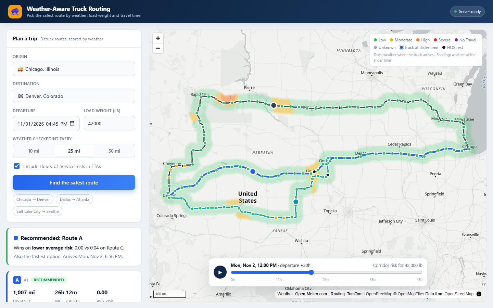

# Weather-Aware Truck Routing

A React + Django app that helps a truck driver pick the safest route. It takes origin, destination, departure time and load weight. It generates **3 truck routes**, samples the forecast at **10 / 25 / 50-mile checkpoints at the truck's ETA**, classifies risk with the brief's weather and load rules, and **recommends a route**. A **0–48 h corridor heatmap** with a forecast slider sits on top.

| | |
|---|---|
| **App** | _add Vercel URL_ |
| **API** | _add Render URL_ (`GET /api/health`) |
| **Walkthrough** | _add Loom URL_ |



## How it works

```
origin, destination, departure, load
        │
        ▼
TomTom truck routing ──► 3 routes (polyline + cumulative distance/time per point)
        │                    └─ fewer than 3? force detours via perpendicular waypoints
        ▼
checkpoints every N miles ──► ETA = departure + driving time + HOS rests
        │
        ▼
Open-Meteo hourly forecast (one batched request for every checkpoint + heatmap cell)
        │
        ▼
risk per checkpoint ──► miles per level per route ──► ranking ──► recommendation
        │
        ▼
corridor grid × 49 hours ──► browser builds 49 heatmap frames once ──► slider swaps frames
```

- **Routing:** TomTom Calculate Route in truck mode. It uses gross vehicle weight (load + 35,000 lb assumed tare, capped at 80,000 lb), a 65 mph governed speed, traffic, and the departure time. Each route comes back with a progress array, so the ETA at any mile is exact rather than estimated from average speed.
- **Three routes, guaranteed.** Routing APIs often return fewer than three alternatives on long trips. When that happens the backend routes through a via point offset perpendicular to the main route (at the midpoint, then at the thirds). It drops near-duplicates (more than 90% overlap) and anything slower than 1.4× the fastest route. If three routes genuinely don't exist, the UI says so instead of showing a junk detour.
- **Weather:** Open-Meteo, keyless, with mph and in/hr returned directly. Each checkpoint is snapped to a 0.1° cell and deduplicated, all locations go out in POST batches, and each location's hourly series is cached for an hour.
- **Heatmap:** the API returns raw wind, rain and snow for a corridor grid (within 25 mi of any route, at most 220 cells, coarser cells for long trips) for 49 hours. The browser interpolates the raw values per pixel and **then** classifies them with the same rule table the backend uses. It builds 49 frames once, and the slider only swaps a texture (`ImageSource.updateImage`). Scrubbing triggers no network calls and no layer re-layout.

## Interpretations

The brief leaves some details open. Each choice below is deliberate and covered by tests.

| Question | Decision | Why |
|---|---|---|
| Values on a shared edge (0.25 in/hr, 35 mph) | Each band includes its lower edge, so the value goes to the **higher** band | Safer. It also closes the integer gaps in the wind table (34.5 mph is Moderate). |
| Rain exactly 1.00 in/hr, snow exactly 3.0 in/hr | **Severe** | The table says No Travel is strictly `>1.00` / `>3.0`. |
| "Wind" | Sustained 10 m wind. Gusts are shown in the popup only. | Matches how the thresholds are normally meant. Gusts would push ordinary Plains days into High. |
| Combining conditions | Level = max(load-adjusted wind, rain, snow) | Worst hazard wins. Conditions are not summed. |
| Load rules | Apply to wind only, only raise a level, and use strict `>30,000` / `>40,000` lb | Literal reading. Note that at 35,000 lb, 45–54 mph is No Travel but 35–44 mph stays High. |
| Rain rate | `rain + showers`, never `precipitation` | `precipitation` includes snow water, which would count snow twice. |
| Forecast hour at an ETA | Wind is interpolated between hours. Rain, snow and gusts come from the hour bucket containing the ETA. | Open-Meteo wind is instantaneous, while precipitation is a total over the *preceding* hour. |
| "10 / 25 / 50 miles" | A user-selectable checkpoint interval | Checkpoints sit at exact mile marks plus the origin and the destination. |
| "Severe miles" | Midpoint rule: each checkpoint covers half the gap to each neighbour | Per-level miles add up exactly to the route length (the UI shows this). |
| No Travel in the ranking | Added **fewest No Travel miles**, then **fewest Unknown miles**, before the brief's four keys | Otherwise a route with No Travel segments could win on "fewest Severe miles", and a route whose forecast failed could win on Severe/High miles it was never measured on. If every route has No Travel, the UI shows a warning instead of a "Recommended" badge. |
| Average risk | Distance-weighted, Low = 0 … No Travel = 4 | Keeps it in the same mile-based terms as keys 1 and 2. |
| Balancing risk and time | Strict lexicographic order. Miles compare at 0.1 mi, average risk at 0.01, time at the minute. | The brief gives an ordered preference list. The UI names the key that decided. |
| Truck ETA | Driving time plus **Hours-of-Service rests** (30 min after 8 h driving, 10 h after 11 h) | Without rests, every checkpoint after hour 11 would be sampled about 10 h early, so it would read the wrong forecast. It can be switched off in the form. |
| Missing forecast | Level **Unknown**, never counted as Low | Shown on the route and flagged on the recommendation. |
| Slider | Hour 0 is the departure hour. The truck markers show where each truck is at that time. | Ties the heatmap to the trip rather than to "now". |
| Departure | From now up to 7 days ahead. Time is UTC internally and local in the browser. | Keeps all checkpoint ETAs inside the forecast horizon. |

Other assumptions: the snow thresholds apply to Open-Meteo's `snowfall`, which is snow depth derived at a fixed 7:1 snow-to-liquid ratio. Beyond about 18–48 h the forecast comes from GFS (about 13 km resolution) rather than HRRR (3 km).

## Project layout

```
backend/
  routing/engine/      pure Python, no I/O: risk, hos, checkpoints, recommend, corridor, weather, geo
  routing/providers/   tomtom (truck routes), alternatives (3-route guarantee), open_meteo, photon
  routing/services.py  the planning pipeline
  routing/views.py     POST /api/plan, GET /api/places, GET /api/health
frontend/src/
  lib/                 risk (table-driven classifier), heatmap (frame builder), api, format
  components/          TripForm, PlaceInput, MapView, ForecastSlider, RouteCards
shared/                risk_cases.json (golden cases) + rules.json — run by BOTH test suites
```

## Run locally

Requires Python 3.12+, Node 20+, and a free [TomTom](https://developer.tomtom.com) key with the **Routing API** product enabled.

```bash
cd backend
python -m venv venv && venv/Scripts/activate      # macOS/Linux: source venv/bin/activate
pip install -r requirements.txt
cp .env.example .env                              # set TOMTOM_API_KEY
python manage.py runserver                        # http://127.0.0.1:8000

cd ../frontend
npm install
npm run dev                                       # http://localhost:5173
```

## Tests

```bash
cd backend && python manage.py test routing   # engine + API (providers mocked at the HTTP layer)
cd frontend && npm test                        # classifier vs the same golden cases
```

`shared/risk_cases.json` holds 36 boundary cases: 24.9 / 25 / 34.5 / 44.9 / 45 / 54.9 / 55 mph; rain 0.10 / 0.25 / 0.50 / 1.00 / 1.01 in/hr; snow 0.5 / 1 / 2 / 3 / 3.01 in/hr; loads of 30,000 vs 30,001 lb and 40,000 vs 40,001 lb. The Python and JavaScript classifiers both have to pass them. A backend test also fails if `shared/rules.json` drifts from the engine's tables.

## Deployment

- **API → Render:** New + → Blueprint → this repo (reads `render.yaml`), then set `TOMTOM_API_KEY` in the dashboard.
- **App → Vercel:** import the repo, set Root Directory = `frontend` and `VITE_API_URL` = the Render URL.

## Limits

- **Weather quota.** Open-Meteo's free tier allows 600 calls/min and 10,000/day per IP, and each location counts as one call. Each plan has a 500-location budget. On very long trips checkpoint weather is read on a coarser grid (the UI says so), and the heatmap gets whatever budget is left. Planning a second new trip within the same minute can return Unknown weather. When that happens the UI says so, the result isn't cached, and retrying a minute later works. `OPEN_METEO_URL` can point at a paid endpoint or a proxy.
- **Free hosting cold start.** The Render free tier sleeps when idle. The app pings `/api/health` on load and shows the server state.

Data: routing © TomTom, weather © [Open-Meteo.com](https://open-meteo.com) (CC BY 4.0), map © OpenFreeMap / OpenMapTiles / OpenStreetMap contributors.
